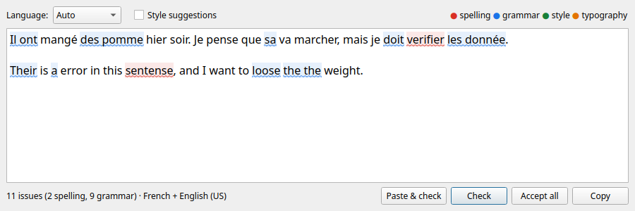

# Correcteur

A small desktop grammar checker for French and English. Paste text, press
**Check**, click an underlined word to fix it, copy the result back.

Checking is done by [LanguageTool](https://github.com/languagetool-org/languagetool),
running as a private server on your machine: no account, no subscription, and
the text never leaves your computer. The server starts when the window opens and
stops when it closes, so nothing stays in memory between uses.



## Install

Requirements: Linux, Python ≥ 3.11, and a Java runtime ≥ 17. On X11, Qt also
needs `libxcb-cursor0` (Debian/Ubuntu: `sudo apt install libxcb-cursor0`).

```bash
pip install git+https://github.com/corentinravoux/correcteur   # or: pip install -e . from a clone
correcteur --download --ngrams fr,en   # LanguageTool into ~/.local/share/correcteur
correcteur --install-desktop           # adds "Correcteur" to the application menu
```

The n-gram data is optional but improves the detection of confused words
(*their/there*, *a/à*, *sa/ça*). It is large: French 1.8 GB, English 9 GB to
download (18 GB unpacked for both). Without `--ngrams` only the engine is
fetched (250 MB).

## Use

Start **Correcteur** from the menu, or run `correcteur`.

| Action | How |
|---|---|
| Check | **Check** button or `Ctrl+Enter` |
| Paste the clipboard and check it | **Paste & check** or `Ctrl+Shift+V` |
| Fix one issue | click the underlined text, pick a suggestion |
| See the explanation | hover the underlined text |
| Apply every first suggestion | **Accept all** (`Ctrl+Z` undoes it) |
| Copy the text | **Copy** or `Ctrl+Shift+C` |

Colours: red spelling, blue grammar, green style, orange typography.
**Style suggestions** enables LanguageTool's "picky" rules (wordiness,
repetitions…). In **Auto** mode each paragraph is checked in its own language,
so French and English can be mixed in one text.

**Accept all** takes the first suggestion each time, which is not always the
right one (*des pomme* → *de la pomme* rather than *des pommes*); look over
the result.

A menu entry *Add to dictionary* teaches it your own words; they are stored one
per line in `~/.config/correcteur/dictionary.txt`.

Without the window:

```bash
correcteur --check notes.txt            # prints line:column, issue and suggestion
echo "Il ont faim." | correcteur --check - --language fr
```

## Configure

Optional, in `~/.config/correcteur/config.toml`:

```toml
engine_dir = "~/Software/languagetool"        # a LanguageTool-X.Y folder, or its parent
ngrams_dir = "~/Software/languagetool/ngrams"  # folder holding en/ and fr/
java = "java"
heap = "1g"                                     # Java memory limit
english_variant = "en-US"                       # used by Auto: en-US or en-GB
dictionary = "~/.config/correcteur/dictionary.txt"
```

## Develop

```bash
pip install -e ".[dev]"
pytest          # the integration tests run only when LanguageTool is installed
```

## Licence

MIT. LanguageTool is LGPL-2.1 and is downloaded separately, not bundled.
